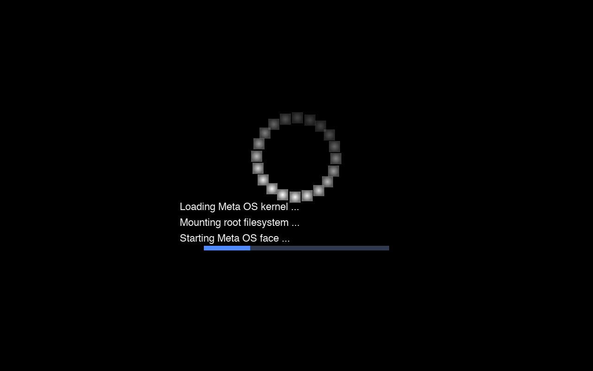
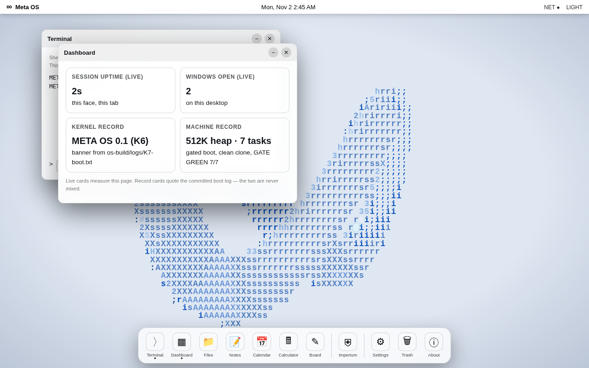
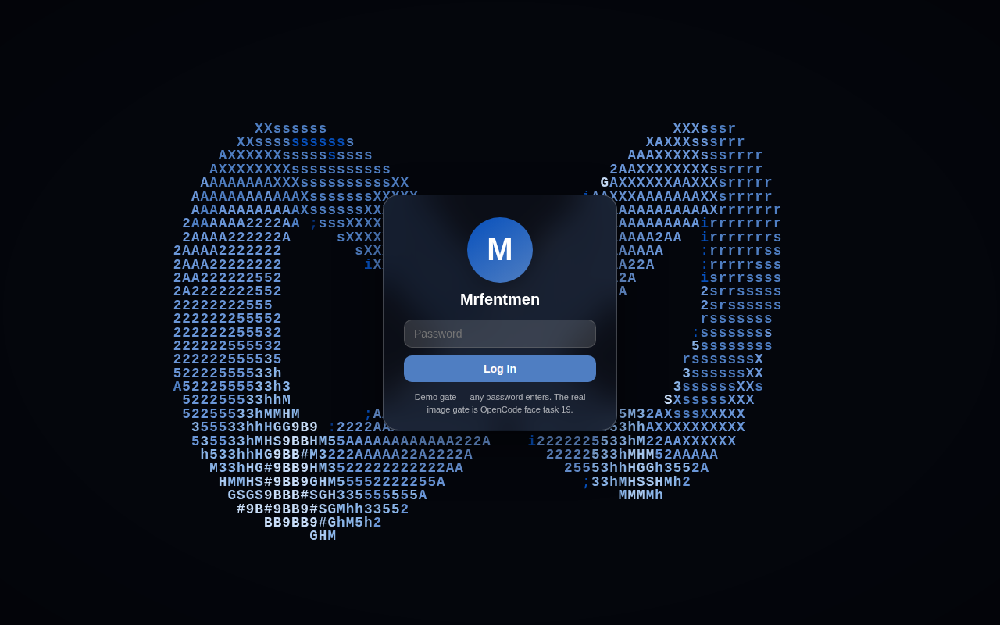
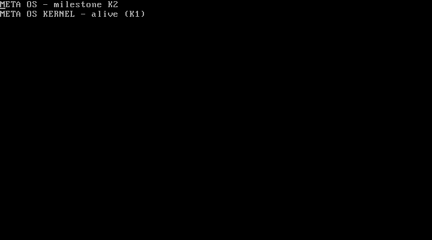
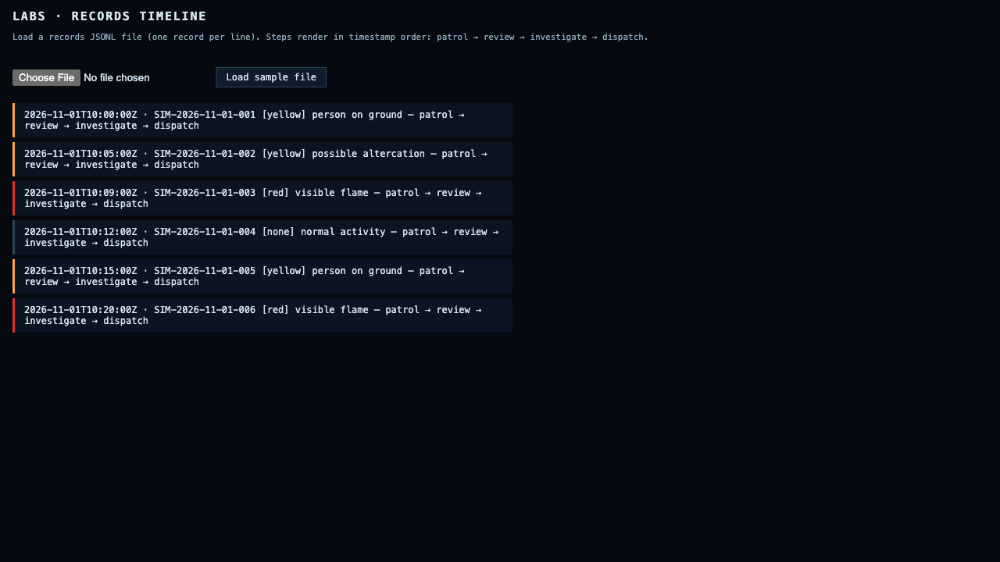

<p align="center">
  
</p>

# Meta OS

**A platform that never sleeps.**

[Live crew viewer](https://muse-relay-live.pages.dev) · [Task list](os-build/TASKS_V3.md) · [OpenCode tasks](os-build/OPENCODE_TASKS_100.md) · [Commit history](https://github.com/Mrfentmen/meta-os/commits/main)

   

Built for the **Meta Global AI Developer Hackathon 2026**, Indie track.

Meta OS is a platform. Systems plug into it, the way departments plug into a city. Each system is a place built for an AI agent to work in: a watch floor, a science lab, a workshop, a studio. The agent lives there, works around the clock, and keeps records of everything it does.

One person directs the build. Del, known as Mrfentmen, makes the calls and does the final testing on his Mac. A crew of AI agents builds the rest in lanes, checks each other's work, and reports what is real and what is not. Nothing in this repo is a mock up presented as finished. Where something is partial, the page says so, in the open.

## Why Meta OS

- **People sleep. Agents do not.** A human watch officer tires, misses things, and goes home. An agent on a patrol loop keeps the same attention at hour one and hour nine hundred. Meta OS is built around that gap.
- **Institutions, not apps.** A consumer app waits for a person to open it. An institution runs whether anyone is watching or not. Every system here is an institution with a job, a memory, and rules it cannot break.
- **The output compounds.** Patrol records, lab results, workshop designs, and studio takes all stay on file. Each day of running makes the next day smarter. Nothing is thrown away, and failures are kept on the record too.
- **Claims stay honest.** Every system grades its own work against rules it cannot bend. A design is proven only when a separate check says so. A detection is a flag for a human, never a verdict. If a number cannot be shown, it does not get printed.

## The systems

<p align="center">
  
</p>

| System | What it does | Status today |
| --- | --- | --- |
| Meta Imperium | Watches public camera feeds and flags scenes for human review across police, fire, and EMS divisions | Working. The flagship system, and the hackathon submission core |
| Meta Scientia | A science lab. It forms hypotheses, runs experiments, and grades evidence on a ladder it cannot skip | Built and merged. The full wave-1 build (literature, reasoning, compute, cycle, verify, repository, Hortus, gateway) passes its 163-test suite; detail in its own section below |
| Meta Officina | A workshop. A person describes an invention in rough words and the workshop designs it, tests it, and writes the full pack | Working in main. Stages 1 and 2a are in, with the design loop and a held out proof gate |
| Meta Custos | RETIRED (2026-11-02) as a standalone system. It was a night watch for machines — patrols of certificates, services, and known exploited vulnerabilities — and that watch idea now lives in the OS's agents | Retired — not a current system |
| Meta Musica | A music studio that never closes. It composes, keeps the takes it likes, and learns from the ones it keeps | In build now, with a 3D notes scene on the OpenCode task list |
| Meta Faber | The loop that improves Meta OS itself, one checked change at a time, with a stop switch and a rollback rule | UNIMPLEMENTED. Named in one document; there is no Faber code in this repo yet |
| Meta OS, the kernel | Our own Rust kernel: boots to its own text console, schedules tasks, runs ring-3 programs, answers a shell | K1-K5 proven by committed boot logs; K6 proven except that no Goose service has a process yet (`os-build/KERNEL_STATUS.md`) |

## Meta Imperium

Imperium is the system that proves the platform. It watches configured public test feeds and works a loop that never waits for a person: patrol, review, investigate, record, respond. The crew inside it is deterministic code around one model. Every assessment comes from Muse Spark 1.3, and the loop itself makes no guesses of its own.

| Division | Watches for | Accent |
| --- | --- | --- |
| Vigiles | Visible signs of trouble on streets: disputes, weapons in view, damaged property | Blue |
| Ignis | Fire and smoke: flames, smoldering, hazard signs across 17 scene categories | Orange |
| Medicus | EMS scenes only: a person on the ground, a crowd around a person, blocked crew access. Never a diagnosis, never a cause, never a treatment word | Green |

**How a flag works.** A small sign is yellow: recorded, shown to a human, and the chain stops there. A big sign is red: the full chain runs, with an investigation capped in steps and spend, and a response sent only to a clearly labelled simulated dispatch endpoint. Red means flagged for human review. It never means an incident is confirmed.

**Identity rule.** The system describes what a person looks like and never puts a name to a face. Evidence crops are taken only on flagged events, BOLO cards read ID: UNIDENTIFIED, and a false alarm purges its evidence. That line does not move.

**Our own numbers.** We claim our own data and nothing else. In our second evaluation batch, 100 frames went through the live pipeline: 42 matched the expected call, 46 were held back as unsure, and there were 0 real misses. All 11 scored misses turned out to be frames taken before the event began. Category validity was 100 of 100, and Vigiles produced zero false altercations across both batches. On 2026-10-30 a live New York City DOT camera snapshot ran the full loop through the queue and came back as a valid assessment in about 6.4 seconds. One honest limit, stated plainly: the flagged path has not yet fired on a live wild event. It has fired in staged runs, and the film below shows one.

**Status: VERIFIED** for the pipeline itself — patrol, review, judge, records, and the simulated response run end to end as real code (`server/queue/`), covered by the 296-test Python queue suite. **Proof:** the committed live reading in `server/queue/livecam_records/` — a real New York City DOT camera frame (Bay Pkwy @ 78 St, Brooklyn, 2026-11-02) assessed by Muse Spark 1.3 through the production path — and the evaluation record in `os-build/demo/EVAL4.md` (80% match, 20% held, 0% miss; emergencies 5 of 5; false flags 0 of 8). Dispatch, when a flag confirms, goes only to a clearly labelled **simulated** loopback endpoint; the code refuses every non-loopback dispatch URL. There is no code path to a real emergency service.

<p align="center">
  
</p>

*The Imperium command console. This frame is from our own screen footage, taken before the backend started, so the console says the model backend is not connected. In that state the app shows no results at all. It never invents one.*

<p align="center">
  
</p>

*A staged Medicus scene from the demo film, rendered with mannequins, not people. The card shows the rules in action: ID stays UNIDENTIFIED, and the response line reads EMS NOTIFIED, SIMULATED.*

<p align="center">
  
</p>

*The demo film city from above, built from real New York City open data building footprints. This is a film render and is labelled as one wherever it appears.*

## Muse Spark on the Meta Model API

Every assessment in Imperium is produced by **Muse Spark 1.3** on the Meta Model API. There is no other model in the loop.

| Setting | Value |
| --- | --- |
| Base URL | `https://api.meta.ai/v1` |
| Model | `muse-spark-1.3` |
| API key | Set as the `SPARK_API_KEY` environment variable. Without it the stack starts in a labelled NOT CONFIGURED mode and shows its disconnected state |
| Spend guardrail | A hard cap of 75 dollars for the event. At the cap, calls are refused, never retried |

Model output is never trusted as returned. It must validate against the frozen v2 contract on the server and again in the client, or it is rejected as an error.

## Run it locally

You need Node.js 24 and Python 3.

```sh
# The Imperium web console on its own — a browser UI, not the OS
# (the OS is the kernel in kernel/, booted per kernel/BUILD_LOG.md).
# Any static server works:
python3 -m http.server 8000
# open http://localhost:8000

# The full stack, server and queue and agents
./run-stack.sh
```

Camera access needs a secure context: `localhost` counts, as does HTTPS.

## Test numbers

Every number below was measured on the current main on 2026-11-02. Recheck any of them with the commands in the next table column.

| Suite | Result | Run it with |
| --- | --- | --- |
| Node (app, server, eval harnesses) | 2071 run, 2016 pass, 55 fail | `npm test` |
| Rust workspace | 2186 pass, 0 fail | `cargo test --workspace` |
| Python job queue | 296 pass, 1 skip | `python3 -m unittest discover -s tests/queue-python` |
| Python Officina | 49 pass | `python3 -m unittest discover -s tests/officina` |
| Python Science Lab | 163 of 163 pass | `python3 -m unittest discover -s tests/science-lab` |
| Python Hortus | 14 pass | `python3 -m unittest discover -s os/tests -p "test_hortus*.py"` |
| Rust intel crate | 186 of 186 lib tests pass; b10_parity 53 of 53 | `cargo test -p intel` |
| Worlds packs | 12 of 12 valid | `python3 os/worlds/validate_pack.py` |
| OS loop harness | 11 of 12 pass — the `green cycle` scenario fails and stays on the record | `bash os/os/loop-tests/metaos-loop.test.sh` |

The 55 Node failures are one known set: tests written for the old native SwiftUI screens, which were removed when the native app moved to a web view shell. They say nothing about the running app. Each one is classified as update or carve out in `docs/NATIVE_TEST_PREP.md`, and the crew is working that list now.

## Sampling and honesty

Analysis uses sampled frames, not continuous video. The console shows the sampling interval on screen at all times: one frame every N seconds goes to the endpoint, and events between samples are not seen. Frames are encoded in memory, sent only to the configured endpoint, and never stored by the app. Confidence in a result is the model's self report, not measured accuracy, and the interface words it that way.

The rules the whole repo runs on:

- Simulated things are labelled SIMULATED everywhere they appear.
- This system never contacts a real emergency service. There is no code path that can.
- Assessments describe visible evidence and uncertainty. They never name a person.
- Failed runs and failed designs stay on the record. The record is the product as much as the wins are.

## The assess contract

One frozen shape, shared by the web console and the native app. The server returns exactly this shape or an error object, which the client reports as a failure.

Request, one per sampled frame:

```json
{
  "product": "vigiles | ignis | medicus",
  "timestamp": "2026-10-28T10:15:00.000Z",
  "image": "data:image/jpeg;base64,..."
}
```

Response:

```json
{
  "product": "vigiles",
  "timestamp": "ISO-8601 timestamp",
  "observations": [
    {
      "category": "observable category",
      "description": "what was observed",
      "evidence": "visual evidence",
      "confidence": 0.72
    }
  ],
  "assessment": {
    "category": "assessment category",
    "summary": "brief explanation",
    "uncertainty": ["what cannot be determined from the evidence"],
    "requires_human_review": true
  },
  "processing": { "model": "model identifier", "latency_ms": 812 }
}
```

A missing confidence or latency key is rejected even though a null value is accepted. Booleans are never accepted as numbers. Extra fields are tolerated.

## Built with

| Piece | Used for |
| --- | --- |
| Rust | The operating system core and services port, 2186 tests green |
| Node.js | The app server, the console tooling, and the test suites |
| Python | The job queue, the agent crew, and the world packs (Imperium divisions, Scientia, Officina, and the retired Custos pack) |
| Muse Spark 1.3 | Every model assessment, through the Meta Model API |
| MapLibre GL | The city map in the console, vendored into the repo |
| Three.js | The demo film city and scenes, and the coming 3D viewers for Scientia compounds and Musica notes |
| OpenCV | Face detection for evidence crops on flagged events only. Detection, never identification |

## Repository map

| Path | What lives there |
| --- | --- |
| `index.html`, `js/`, `styles.css` | The web console: camera, frame sampler, analysis client |
| `server/` | The Node server behind the assess endpoint, with the direct Spark transport |
| `server/queue/` | The job queue service and the resident agent crew |
| `os/` | The Meta OS tree: services, the job queue, the dashboard, and the world packs under `os/worlds/` |
| `kernel/` | The Meta OS kernel: boot, memory, scheduler, syscalls, console, keyboard. Rust, `no_std`. Build recipe in `kernel/BUILD_LOG.md` |
| `services/` | 25 Goose system services over 18 shared libraries, run as host processes today, not yet booted on the kernel |
| `crates/` | The Rust workspace: the port of the OS and services to Rust |
| `native/` | The macOS app shell that hosts the console in a web view |
| `relay/` | Meta Nuntius, the product's own relay and viewer |
| `eval/`, `test-footage/` | The evaluation sets and the frame packs used to test them |
| `tests/` | The Node and Python test suites |
| `docs/` | Supporting documents, including the hardware verification checklist |
| Root documents | `BRIEF.md` and `MASTER_DIRECTIVE_V2.md` define the build. `TASKS_V3.md` holds the crew lanes. `OPENCODE_TASKS_100.md` holds the Mac side tasks |

## Roadmap

**Now, hackathon week**

- The full end to end test on the director's Mac, then submission
- The three minute platform film, cut from the shot library
- The night watch, built into the OS's agents (Custos retired as a standalone system on 2026-11-02)

**Next**

- Scientia lands in main, and its first reproduction gate gets a blind second run from a crew verifier
- The 3D viewers: chemical compounds for Scientia, music notes for Musica
- The 55 old native tests, updated or carved out one by one

**Later**

- A pass on real hardware: real cameras, a real phone, the image booted on a real machine
- More departments as world packs, with no changes to the core

## The crew

- **Del (Mrfentmen)** directs. He sets the direction, makes the calls no agent may make, and runs every Mac side proof himself.
- **Pax** coordinates the build, checks finished work lane by lane, and merges what passes.
- **Rowan, Hana, and Milo** build in lanes: the platform, interface and Musica and Scientia surfaces, Officina and evaluation.
- **Buffy** built early Rust batches.
- **OpenCode** runs on the director's Mac and takes the jobs only a Mac can do: compiling, clicking, booting, recording.

## The operating system underneath

Meta OS is not only the systems. Underneath them sits a real
operating system, built in the open in this repo:

- **A bare-metal kernel** (`kernel/`, Rust, about 5,800 lines across 13 files):
  boot, memory map and page tables, a scheduler, ring-3
  userspace, fault isolation, and a shell that reports the
  machine's real state. The claim is one sentence and every
  clause is backed by a committed boot log: *Meta OS boots on
  x86_64 in QEMU, drops to ring 3, runs three userspace
  programs, isolates a fault to one task, and gives you a
  shell that reports the machine's real state — reproduced
  from a clean checkout by one command.*
- **Seven layers**: L1 boot, L2 kernel core, L3 drivers
  (Rust), L4 system services (Goose), L5 agent runtime
  (Lobster), L6 shell and apps, L7 programs. The Rust OS
  layer is 19 crates; the whole OS side — kernel, crates, the
  Python root they port, the agent layer — is roughly
  122,000 lines, tests excluded.
- **The agent layer** (`agents/`): named, badged agents with
  budgets, memory, and an append-only ledger; a watchman that
  wakes the right agent when work lands; a baton pass so a
  job continues instead of restarting; and a shared lessons
  file so what one agent learns, the whole crew gets.
- **Meta Nuntius** (`relay/`): the OS's own messaging — how
  agents and rooms talk inside the platform.
- **The kernel build-out** is specified in
  `os-build/KERNEL_BUILDOUT_SPEC.md`: graphics, typed input,
  demand paging, copy-on-write, swap, inter-task messaging,
  storage and a filesystem, and drivers — each with the boot
  log that will prove it.

## More of the platform

- **Meta Aegis** — the cybersecurity system: sweeps the
  project's own ground (repos, shipped servers, sites)
  against known-vulnerability and secret-hygiene checks,
  findings as records, never a value printed.
- **Meta Nervus** — the neuron-surgery bench: the tools from
  the Neuron Surgery research, wired as a program for people
  and a tool tray for agents — sweep, steer, ablate, and
  prove every change before and after.
- **Science Lab** — bright lab, evidence ladder on every
  claim, a 13-agent research team; Hortus, its breeding
  engine, lives inside it.
- **Officina** — the invention workshop: starts from a plain
  description, researches prior art, and generates its own
  designs and blueprints.
- **Musica** — the dark studio: an agent that keeps music
  sessions alive around the clock.
- **Hands-Free** — the whole crew run by voice: talk orders,
  hear briefs, approve out loud.

## The programs, one by one

Every program in the platform, with its honest state on
2026-11-02 and the proof that backs the claim. The labels mean
exactly this: **VERIFIED** — run and proven, with the named
artifact in the repo. **CODE-INSPECTED** — the code exists and
has been read and test-covered, but the named run has not
happened yet. **UNIMPLEMENTED** — not built; named here so
nobody has to guess. **BLOCKED** — built or designed, waiting
on one named thing outside the code.

### The kernel (L1–L3)

Our own bare-metal kernel in `kernel/` (Rust, `no_std`, about
5,800 lines across 13 files): boot, memory map and page
tables, scheduler, ring-3 userspace, fault isolation, a text
shell that reports the machine's real state.

**Status: VERIFIED** for the text-boot machine. **Proof:**
four committed QEMU boot logs (`os-build/logs/K1-boot.txt`
and runs 1–3), and the combined tree's gate at `c7aeb162` —
gate GREEN 7/7 with the serial log at
`os-build/logs/WAVE3-combined-serial.txt` (banner, alive line,
readkey `got=3`, the fetch screen, `status`/`mem`/`ps`
answered with real state, bad syscall 99 refused, a faulting
task killed while the shell keeps answering, panic count 0).
The standing soak record is 73 minutes with 0 panics
(R5-5); the 2-hour soak verdict is still **PENDING**.

Two build-outs are in flight, stated plainly:

- **Demand paging (K3): CODE-INSPECTED.** The build is landed
  and gate-1 GREEN (compile and test gate). The Mac boot gate
  — one boot proving the demand leg, crasher containment, and
  the outside-region refusal — is still owed, so K3 is not
  called proven.
- **Inter-task messaging (K4 IPC): CODE-INSPECTED.** The
  mailbox build (syscalls 6 and 7, dispatched in `user.rs`
  only; `syscalls.rs` stays frozen) is landed. Its gate-1 and
  Mac boot gates are still owed.
- **Kernel graphics: UNIMPLEMENTED.** A framebuffer driver
  file exists (`kernel/src/framebuffer.rs`, 576 lines) and is
  not wired to anything: the pinned bootloader (0.9.35) hands
  the kernel no framebuffer. The fix is a written build order
  (`os-build/KERNEL_FACE_BUILD_ORDER.md`, Route 1: bootloader
  upgrade, then wiring, then the kernel draws the boot screen
  and a window holding the real shell). Until its screendump
  proof pack exists, the kernel's screen is the text console.

### Goose services (L4)

The system-services layer, written in Goose: 25 services over
18 shared libraries — supervisor, logging, a log-structured
filesystem, storage, time, network protocol pack, shell, agent
host — each with a test program compiled and run as a real
host process.

**Status: CODE-INSPECTED.** **Proof:** the committed run
record — 33 programs, 1,253 checks, 0 failed — in
`os-build/layer1/SERVICE_RUNS.md` with raw transcripts in
`os-build/layer1/TRANSCRIPTS.md`. The honest boundary, stated
in that directory itself: **this layer is not booted.** It
runs as host processes over a substituted syscall surface;
no Goose service has a process on the kernel yet.

### The agent layer, the Gym, and the Graft (L5)

Named, badged agents (`agents/`): a host runtime, a registry
of 28 agents with budgets, a watchman that wakes the right
agent when work lands, a baton pass so a job continues
instead of restarting, and an append-only ledger. The **Gym**
(`agents/gym.mjs`) drills agents on recorded scenarios. The
**Graft** (`agents/lessons.mjs`) is the shared lessons file:
what one agent learns, the whole crew gets.

**Status: VERIFIED on the host** — the runtime, watchman,
baton, and gym run with their own test suites, and the
agentic proof record is `os-build/AGENTIC_PROOF.md`.
**UNIMPLEMENTED:** an agent running inside the bare-metal
kernel. L5 in-kernel is design only today.

### The Lobster shell (L6)

The shell layer. Two parts, two different states:

- The kernel's own text shell: **VERIFIED.** It answers
  `status`, `help`, `uptime`, `mem`, and `ps` with the
  machine's real state on the real keyboard — proof is the
  combined serial log named under the kernel above.
- The Lobster language and its programs (`lobster/`):
  **CODE-INSPECTED.** Programs exist and run on the host
  through the services layer; the windowed shell — the real
  shell answering inside a kernel-drawn window — is
  **UNIMPLEMENTED** and is the top of the kernel-face build
  order.

### Meta Imperium (Vigiles · Ignis · Medicus)

The watch system, covered in full above. **Status:
VERIFIED** as a pipeline (proof: the queue suite, the
committed live DOT reading, `os-build/demo/EVAL4.md`).
Medicus is EMS **scene awareness only** — a person on the
ground, a crowd around a person, blocked crew access — never
a diagnosis, a cause, a severity, or a treatment word.
Dispatch is simulated loopback only, enforced in code.
**UNIMPLEMENTED:** nothing in the pipeline; the open item is
an event, not code — the flagged path has not yet fired on a
live wild scene.

### Science Lab and Hortus

The science system (`os/worlds/science-lab/`): a 13-agent
research team, an evidence ladder (levels 0–6) that no claim
can skip, a controlled gateway to the director's own research
servers, and **Hortus**, its breeding engine, living inside
it.

**Status: VERIFIED on the host.** **Proof:** the 163-test
suite (`tests/science-lab`), the 14 Hortus tests, and the
dress rehearsal on file in
`os/worlds/science-lab/SCIENCE_LAB_STATUS.md` — a fresh
chemistry question answered end to end, a blind re-run
agreeing with the first run, the claim held at ladder level 2
by the gate. Named limits: automated ladder promotion is
capped at level 3; the cycle's step 8 exists only as an
always-blocking UNIMPLEMENTED marker; remote gateway adapters
and levels 4–6 automation are **UNIMPLEMENTED**.

### Officina

The invention workshop (`os/worlds/officina/`): starts from
a plain description, researches prior art and patents, and
generates its own designs, schematics, and blueprints.

**Status: VERIFIED for stages 1 and 2a** — the 49-test
Python suite passes and the stage-2a proof gate
(`os-build/officina_2a_gate.py`) passes 14 of 14. The
workshop's own design loop is **CODE-INSPECTED** (merged,
with its stop file and rollback rule). Stages 2b, 2c, and 2d
are **UNIMPLEMENTED** and sit on the crew's task lists as
named work, not as claims.

### Musica

The music studio (`os/worlds/musica/`): an agent that keeps
music sessions alive around the clock, keeps the takes it
likes, and learns from the ones it keeps.

**Status: CODE-INSPECTED, in build.** Its overnight keeper
loop is proven on the host (record in
`os-build/AGENTIC_PROOF.md`) and its test suite passes 4 of 4
on the Mac; its registry entry is still a draft command, so
Musica is not called a running service. The dark-studio face
with 3D notes is **UNIMPLEMENTED** — it is design and task
list today.

### Meta Aegis

The cybersecurity system (`aegis/`): sweeps the project's own
ground only — its repos, shipped servers, and sites — against
known-vulnerability data and secret-hygiene checks. Findings
are records with severity; a secret is only ever counted,
never printed; nothing is auto-fixed.

**Status: CODE-INSPECTED.** The modules and their test suites
exist (`tests/aegis-findings.test.mjs`,
`tests/aegis-manifests.test.mjs`) and the hosted runner exits
clean. **UNIMPLEMENTED:** the first real sweep has not run
yet — it is a named crew task, and until its findings ledger
exists, Aegis claims tooling, not results.

### Meta Nervus

The neuron-surgery bench (`nervus/`): the tools from the
director's Neuron Surgery research wired as a program —
sweep, steer, ablate, evaluate the delta, map the layers —
with dose windows and a provenance ledger.

**Status: CODE-INSPECTED.** The contracts, tool tray, and
hosted stub lane exist and are test-covered. **UNIMPLEMENTED:**
a real model operation. Nervus has never steered a real
neuron; real runs belong to the machine that holds the model,
and the face feed contract for Nervus does not exist yet.

### Hands-Free

The crew run by voice (`handsfree/`): talk orders, hear
briefs, approve out loud.

**Status: CODE-INSPECTED for the text-first services** —
intake, brief composition, and approval modules are built and
test-covered. The voice front end is **BLOCKED**: the model
API's transcription surface is unresolved (see the model
layer below), so Hands-Free takes typed input today and
claims no voice run.

### Meta Nuntius — relay and board

The OS's own messaging (`relay/`, `board/`): a zero-dependency
Node relay on port 8787 and the board rooms plug into, so
agents and people talk inside the platform. (The crew's own
operations bus is a separate thing and is not a product
dependency.)

**Status: VERIFIED as host software** — `relay/relay.mjs`
and `board/board.mjs` ship with their own test suites
(`relay/relay.test.mjs`, `board/board.test.mjs`).
**UNIMPLEMENTED:** wiring the board into the kernel shell's
own interface.

### Live cameras (NYC DOT)

The live input path (`server/queue/livecams.py`): New York
City DOT public traffic cameras, fetched as stills and run
through the production Imperium assessment.

**Status: VERIFIED.** **Proof:** the committed frame and
reading in `server/queue/livecam_records/` — Bay Pkwy @ 78 St
(Kings Hwy), Brooklyn, captured 2026-11-02, assessed by Muse
Spark 1.3 through the production path as "normal activity"
with its uncertainties stated. The module's offline tests are
part of the 296-test queue suite. Other networks' feeds
(EarthCam and similar) are embed-only and are never pulled —
their licences do not allow it, and the code does not try.

### The model layer

One client (`server/queue/models.py`) behind one endpoint,
four models wired, each on the surface that was actually
verified live against the API — a listed model is never
assumed callable:

| Model | Surface | Status |
| --- | --- | --- |
| Muse Spark 1.3 | chat completions | **VERIFIED** — every Imperium assessment and the model judge run on it |
| Muse Wonder 1.0 | chat completions | **CODE-INSPECTED** — endpoint probe-verified; the review-reader swap is wired behind a flag (`TRIO_REVIEW_WONDER`), its live run still owed |
| SAM 3.1 | responses | **VERIFIED** endpoint — a live call returned a box and mask on a real evaluation frame; patrol wiring is behind a flag (`TRIO_SAM_SEGMENT`), its live flagged run still owed |
| Muse Image 1.0 | responses | **VERIFIED** endpoint — a live call returned a real generated image |
| Muse Voice Transcribe 1.0 | none verified | **UNRESOLVED** — listed on the account, no call surface verified; the client raises instead of guessing, and Hands-Free stays text-first because of it |

The judge is wired the same honest way: a second, independent
reading plus a ruling — deterministic by default, the model
judge behind the `TRIO_JUDGE_MODEL` flag with any fallback
named on the record. The brain seat is swappable by design:
today the endpoint is Muse Spark, and nothing in the OS
changes if a local open-weights model takes the seat. No
model weights are packed into the OS today.

### The face — design reference only

The web desktop pictured under Screens is the **design
reference** for what the kernel will draw: **it is not the
OS, it does not boot, and it is never presented as the OS.**
It runs in a browser on a carrier system so the design can be
seen and clicked today.

**Status: REFERENCE.** The kernel-drawn version of that same
design — boot screen, desktop, one window holding the real
shell — is **UNIMPLEMENTED** and is the top lane of the
kernel-face build order. When a screendump of the kernel
drawing it exists, it will be committed as the proof and
this section will change. Not before.

## Screens

The face image's boot screen — the desktop design running on the carrier image, drawn by the web renderer. The kernel did not draw this; its own screen today is the text console below.



The desktop (light theme) of the face, on the carrier image (Debian + browser) — the design, not a kernel-drawn screen:



The face's login (same carrier image):



The bare-metal kernel's own text console — no face, the real
machine talking:



The systems at a glance:


The Imperium evaluation board — fifteen real scenes, every
emergency named, no false alarms; the border is the score,
the red tag marks a flagged emergency:



## License

No repository `LICENSE` file exists yet. The position, plainly: the code is public to read for
the hackathon, and all rights stay with the author until a license is added. One conflict has
to be settled before any license ships: `kernel/Cargo.toml` declares the kernel crate MIT,
while the repo contains no MIT text and the kernel links the rust-osdev bootloader under its
own terms. That is a Pax ruling plus a `LICENSE` file, not a sentence in this README.

## The services layer

The kernel above boots from its own boot image, and the committed QEMU boot logs are the proof. Beside it sits a services layer written in Goose, the systems language, and built here from source: 25 services over 18 shared libraries — a supervisor, logging with rotation and retention, a log-structured filesystem with a checker, storage, time, the call matrix, the network protocol pack, a shell, and the agent host. It is not a sketch. Every module has a test program that imports it, asserts against it, and is compiled to C and run as a real host process, 33 of them in one command:

```
./os-build/layer1/run_native.sh
ran: 33 programs  RUNS=33  FAILS=0
```

1,253 checks, 0 failed, against real memory and a real clock. The table per program is `os-build/layer1/SERVICE_RUNS.md`, the raw runs are `os-build/layer1/TRANSCRIPTS.md`, and the demo surfaces the layer actually drives are `os-build/layer1/DEMO.md`, `DEMO_SHELL.md` and `DEMO_30S.md`.

The honest boundary, stated the same way everywhere in `os-build/layer1/`: **this layer is not booted.** It runs as host processes with a substituted syscall surface — `os-build/layer1/host/host_shim.c` implements ten `sys_*` calls and refuses five on purpose (`sys_spawn`, `sys_kill`, `sys_net_send`, `sys_net_recv`, and `sys_read_key`, which reports nothing pending forever). A restart recorded in a transcript is the supervisor's decision and its bookkeeping, not a process being killed and brought back. No scheduler, no address space, no NIC. That refusal is why the green runs mean something: a shim that faked those calls would make every transcript pass for a reason that does not exist on the kernel.

What the layer needs from the kernel to stop being a host-side corpus is written down, call by call, in `os-build/layer1/SERVICES_SYSCALL_MAP.md` and `KERNEL_NEEDS_AFTER.md`.

