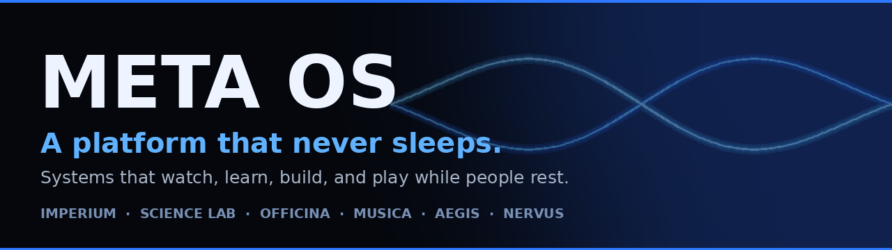
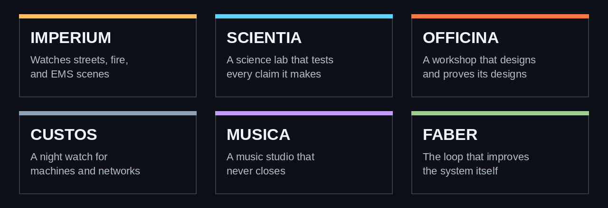
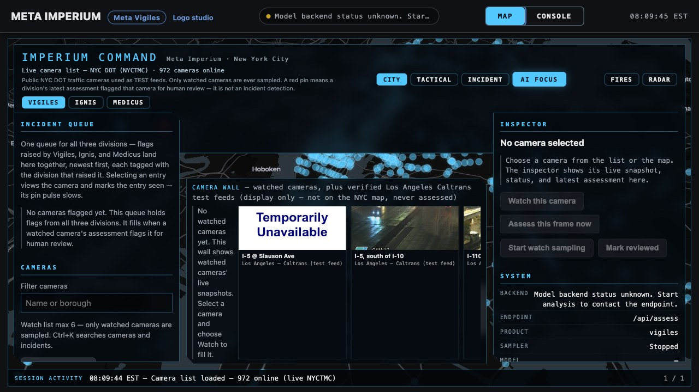
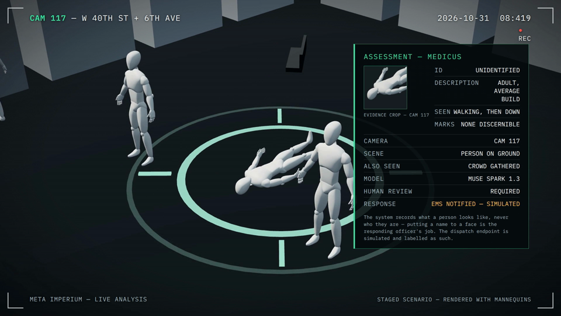
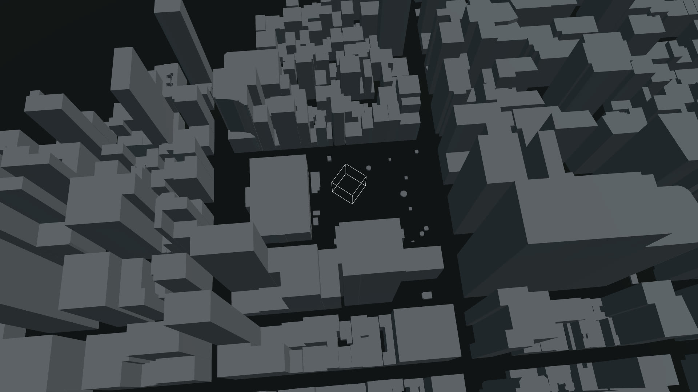

<p align="center">
  
</p>

# Meta OS

**A platform that never sleeps.**

[Live crew viewer](https://muse-relay-live.pages.dev) · [Task list](TASKS_V3.md) · [OpenCode tasks](OPENCODE_TASKS_100.md) · [Commit history](https://github.com/Mrfentmen/meta-os/commits/main)

   

Built for the **Meta Global AI Developer Hackathon 2026**, Indie track.

Meta OS is a platform. Systems plug into it, the way departments plug into a city. Each system is a place built for an AI agent to work in: a watch floor, a science lab, a workshop, a studio. The agent lives there, works around the clock, and keeps records of everything it does.

One person directs the build. Del, known as Mrfentmen, makes the calls and does the final testing on his Mac. A crew of AI agents builds the rest in lanes, checks each other's work, and reports what is real and what is not. Nothing in this repo is a mock up presented as finished. Where something is partial, the page says so, in the open.

## Why Meta OS

- **People sleep. Agents do not.** A human watch officer tires, misses things, and goes home. An agent on a patrol loop keeps the same attention at hour one and hour nine hundred. Meta OS is built around that gap.
- **Institutions, not apps.** A consumer app waits for a person to open it. An institution runs whether anyone is watching or not. Every system here is an institution with a job, a memory, and rules it cannot break.
- **The output compounds.** Patrol records, lab results, workshop designs, and studio takes all stay on file. Each day of running makes the next day smarter. Nothing is thrown away, and failures are kept on the record too.
- **Claims stay honest.** Every system grades its own work against rules it cannot bend. A design is proven only when a separate check says so. A detection is a flag for a human, never a verdict. If a number cannot be shown, it does not get printed.

## The systems

<p align="center">
  
</p>

| System | What it does | Status today |
| --- | --- | --- |
| Meta Imperium | Watches public camera feeds and flags scenes for human review across police, fire, and EMS divisions | Working. The flagship system, and the hackathon submission core |
| Meta Scientia | A science lab. It forms hypotheses, runs experiments, and grades evidence on a ladder it cannot skip | Part built. The breeding engine and the first gate are ready on a branch and land after the Nov 1 full test |
| Meta Officina | A workshop. A person describes an invention in rough words and the workshop designs it, tests it, and writes the full pack | Working in main. Stages 1 and 2a are in, with the design loop and a held out proof gate |
| Meta Custos | A night watch for machines. It patrols certificates, services, and known exploited vulnerabilities | Built and gate checked. It waits on a merge fix where its files overlap the platform files |
| Meta Musica | A music studio that never closes. It composes, keeps the takes it likes, and learns from the ones it keeps | In build now, with a 3D notes scene on the OpenCode task list |
| Meta Faber | The loop that improves Meta OS itself, one checked change at a time, with a stop switch and a rollback rule | Working in main |
| The OS image | A bootable Meta OS disk image with the crew tools baked in and a quiet self update | Built. Boot verified in QEMU with zero failed units |

## Meta Imperium

Imperium is the system that proves the platform. It watches configured public test feeds and works a loop that never waits for a person: patrol, review, investigate, record, respond. The crew inside it is deterministic code around one model. Every assessment comes from Muse Spark 1.3, and the loop itself makes no guesses of its own.

| Division | Watches for | Accent |
| --- | --- | --- |
| Vigiles | Visible signs of trouble on streets: disputes, weapons in view, damaged property | Blue |
| Ignis | Fire and smoke: flames, smoldering, hazard signs across 17 scene categories | Orange |
| Medicus | EMS scenes only: a person on the ground, a crowd around a person, blocked crew access. Never a diagnosis, never a cause, never a treatment word | Green |

**How a flag works.** A small sign is yellow: recorded, shown to a human, and the chain stops there. A big sign is red: the full chain runs, with an investigation capped in steps and spend, and a response sent only to a clearly labelled simulated dispatch endpoint. Red means flagged for human review. It never means an incident is confirmed.

**Identity rule.** The system describes what a person looks like and never puts a name to a face. Evidence crops are taken only on flagged events, BOLO cards read ID: UNIDENTIFIED, and a false alarm purges its evidence. That line does not move.

**Our own numbers.** We claim our own data and nothing else. In our second evaluation batch, 100 frames went through the live pipeline: 42 matched the expected call, 46 were held back as unsure, and there were 0 real misses. All 11 scored misses turned out to be frames taken before the event began. Category validity was 100 of 100, and Vigiles produced zero false altercations across both batches. On 2026-10-30 a live New York City DOT camera snapshot ran the full loop through the queue and came back as a valid assessment in about 6.4 seconds. One honest limit, stated plainly: the flagged path has not yet fired on a live wild event. It has fired in staged runs, and the film below shows one.

<p align="center">
  
</p>

*The Imperium command console. This frame is from our own screen footage, taken before the backend started, so the console says the model backend is not connected. In that state the app shows no results at all. It never invents one.*

<p align="center">
  
</p>

*A staged Medicus scene from the demo film, rendered with mannequins, not people. The card shows the rules in action: ID stays UNIDENTIFIED, and the response line reads EMS NOTIFIED, SIMULATED.*

<p align="center">
  
</p>

*The demo film city from above, built from real New York City open data building footprints. This is a film render and is labelled as one wherever it appears.*

## Muse Spark on the Meta Model API

Every assessment in Imperium is produced by **Muse Spark 1.3** on the Meta Model API. There is no other model in the loop.

| Setting | Value |
| --- | --- |
| Base URL | `https://api.meta.ai/v1` |
| Model | `muse-spark-1.3` |
| API key | Set as the `SPARK_API_KEY` environment variable. Without it the stack starts in a labelled NOT CONFIGURED mode and shows its disconnected state |
| Spend guardrail | A hard cap of 75 dollars for the event. At the cap, calls are refused, never retried |

Model output is never trusted as returned. It must validate against the frozen v2 contract on the server and again in the client, or it is rejected as an error.

## Run it locally

You need Node.js 24 and Python 3.

```sh
# The web console on its own, any static server works
python3 -m http.server 8000
# open http://localhost:8000

# The full stack, server and queue and agents
./run-stack.sh
```

Camera access needs a secure context: `localhost` counts, as does HTTPS.

## Test numbers

Every number below was measured on the current main on 2026-11-01. Recheck any of them with the commands in the next table column.

| Suite | Result | Run it with |
| --- | --- | --- |
| Node (app, server, eval harnesses) | 1933 run, 1877 pass, 56 fail | `npm test` |
| Rust workspace | 1412 pass, 0 fail | `cargo test --workspace` |
| Python job queue | 110 pass | `python3 -m unittest discover -s tests/queue-python` |
| Python Officina | 49 pass | `python3 -m unittest discover -s tests/officina` |
| Worlds packs | 9 of 9 valid | `python3 os/worlds/validate_pack.py` |
| OS loop harness | 12 of 12 pass | `bash os/os/loop-tests/metaos-loop.test.sh` |

The 56 Node failures are one known set: tests written for the old native SwiftUI screens, which were removed when the native app moved to a web view shell. They say nothing about the running app. Each one is classified as update or carve out in `docs/NATIVE_TEST_PREP.md`, and the crew is working that list now.

## Sampling and honesty

Analysis uses sampled frames, not continuous video. The console shows the sampling interval on screen at all times: one frame every N seconds goes to the endpoint, and events between samples are not seen. Frames are encoded in memory, sent only to the configured endpoint, and never stored by the app. Confidence in a result is the model's self report, not measured accuracy, and the interface words it that way.

The rules the whole repo runs on:

- Simulated things are labelled SIMULATED everywhere they appear.
- This system never contacts a real emergency service. There is no code path that can.
- Assessments describe visible evidence and uncertainty. They never name a person.
- Failed runs and failed designs stay on the record. The record is the product as much as the wins are.

## The assess contract

One frozen shape, shared by the web console and the native app. The server returns exactly this shape or an error object, which the client reports as a failure.

Request, one per sampled frame:

```json
{
  "product": "vigiles | ignis | medicus",
  "timestamp": "2026-10-28T10:15:00.000Z",
  "image": "data:image/jpeg;base64,..."
}
```

Response:

```json
{
  "product": "vigiles",
  "timestamp": "ISO-8601 timestamp",
  "observations": [
    {
      "category": "observable category",
      "description": "what was observed",
      "evidence": "visual evidence",
      "confidence": 0.72
    }
  ],
  "assessment": {
    "category": "assessment category",
    "summary": "brief explanation",
    "uncertainty": ["what cannot be determined from the evidence"],
    "requires_human_review": true
  },
  "processing": { "model": "model identifier", "latency_ms": 812 }
}
```

A missing confidence or latency key is rejected even though a null value is accepted. Booleans are never accepted as numbers. Extra fields are tolerated.

## Built with

| Piece | Used for |
| --- | --- |
| Rust | The operating system core and services port, 1412 tests green |
| Node.js | The app server, the console tooling, and the test suites |
| Python | The job queue, the agent crew, and the world packs (Imperium divisions, Scientia, Officina, Custos) |
| Muse Spark 1.3 | Every model assessment, through the Meta Model API |
| MapLibre GL | The city map in the console, vendored into the repo |
| Three.js | The demo film city and scenes, and the coming 3D viewers for Scientia compounds and Musica notes |
| OpenCV | Face detection for evidence crops on flagged events only. Detection, never identification |

## Repository map

| Path | What lives there |
| --- | --- |
| `index.html`, `js/`, `styles.css` | The web console: camera, frame sampler, analysis client |
| `server/` | The Node server behind the assess endpoint, with the direct Spark transport |
| `server/queue/` | The job queue service and the resident agent crew |
| `os/` | The Meta OS tree: services, the job queue, the dashboard, and the world packs under `os/worlds/` |
| `crates/` | The Rust workspace: the port of the OS and services to Rust |
| `native/` | The macOS app shell that hosts the console in a web view |
| `relay/` | Meta Nuntius, the product's own relay and viewer |
| `eval/`, `test-footage/` | The evaluation sets and the frame packs used to test them |
| `tests/` | The Node and Python test suites |
| `docs/` | Supporting documents, including the hardware verification checklist |
| Root documents | `BRIEF.md` and `MASTER_DIRECTIVE_V2.md` define the build. `TASKS_V3.md` holds the crew lanes. `OPENCODE_TASKS_100.md` holds the Mac side tasks |

## Roadmap

**Now, hackathon week**

- The full end to end test on the director's Mac, then submission
- The three minute platform film, cut from the shot library
- The Custos merge fix, so the night watch lands in main

**Next**

- Scientia lands in main, and its first reproduction gate gets a blind second run from a crew verifier
- The 3D viewers: chemical compounds for Scientia, music notes for Musica
- The 56 old native tests, updated or carved out one by one

**Later**

- A pass on real hardware: real cameras, a real phone, the image booted on a real machine
- More departments as world packs, with no changes to the core

## The crew

- **Del (Mrfentmen)** directs. He sets the direction, makes the calls no agent may make, and runs every Mac side proof himself.
- **Pax** coordinates the build, checks finished work lane by lane, and merges what passes.
- **Rowan, Hana, and Milo** build in lanes: platform and Custos, interface and Musica and Scientia surfaces, Officina and evaluation.
- **Buffy** built early Rust batches.
- **OpenCode** runs on the director's Mac and takes the jobs only a Mac can do: compiling, clicking, booting, recording.

## License

No license file yet. The code is public to read for the hackathon. All rights stay with the author until a license is added.

## The services layer

The OS above is the image. Under it sits a services layer written in Goose, the systems language, and built here from source: 25 services over 18 shared libraries — a supervisor, logging with rotation and retention, a log-structured filesystem with a checker, storage, time, the call matrix, the network protocol pack, a shell, and the agent host. It is not a sketch. Every module has a test program that imports it, asserts against it, and is compiled to C and run as a real host process, 33 of them in one command:

```
./os-build/layer1/run_native.sh
ran: 33 programs  RUNS=33  FAILS=0
```

1,253 checks, 0 failed, against real memory and a real clock. The table per program is `os-build/layer1/SERVICE_RUNS.md`, the raw runs are `os-build/layer1/TRANSCRIPTS.md`, and the demo surfaces the layer actually drives are `os-build/layer1/DEMO.md`, `DEMO_SHELL.md` and `DEMO_30S.md`.

The honest boundary, stated the same way everywhere in `os-build/layer1/`: **this layer is not booted.** It runs as host processes with a substituted syscall surface — `os-build/layer1/host/host_shim.c` implements ten `sys_*` calls and refuses five on purpose (`sys_spawn`, `sys_kill`, `sys_net_send`, `sys_net_recv`, and `sys_read_key`, which reports nothing pending forever). A restart recorded in a transcript is the supervisor's decision and its bookkeeping, not a process being killed and brought back. No scheduler, no address space, no NIC. That refusal is why the green runs mean something: a shim that faked those calls would make every transcript pass for a reason that does not exist on the kernel.

What the layer needs from the kernel to stop being a host-side corpus is written down, call by call, in `os-build/layer1/SERVICES_SYSCALL_MAP.md` and `KERNEL_NEEDS_AFTER.md`.

